# Chennai Flood Pulse

[](https://aws.amazon.com/)
[](https://nextjs.org/)
[](https://www.typescriptlang.org/)
[](https://opensource.org/licenses/MIT)

> **Street-level flood risk for the next 3 hours and a safe route that avoids flooded streets — for one Chennai pilot zone.**

**Hackathon:** Environmental Hacks (WeMakeDevs x AWS, Bharat Builds Tour event 02)  
**Track:** Heat and Water  
**Live Demo:** [[https://main.d123456789.amplifyapp.com](https://main.d2u5xebzknb4wl.amplifyapp.com/)]

---

## 1. Problem & Product Definition

During heavy monsoon rainfall in Chennai, city-wide meteorological alerts inform residents that rain is falling, but they cannot answer the commuter's immediate question: *"Is my street safe right now, and how do I navigate around flooded roads?"*

### Primary Users:
- **Daily Commuters & Residents:** Navigating home or work through heavy rain in South Chennai who need to avoid submerged corridors.
- **Ward & Drainage Officials:** Requiring an objective, ranked list of top vulnerable choke points to prioritize water pumping resources.

### The Pilot Zone:
**Velachery – Pallikaranai – Mudichur – Medavakkam** (South Chennai).  
*Why this zone?* Historically, this corridor is the most vulnerable to urban inundation due to the low-lying topography of the Pallikaranai marshland, overflow from Velachery and Narayanapuram lakes, and Adyar river backwater in Mudichur during Cyclone Michaung (2023) and the 2015 floods.

---

## 2. Working Features

- [x] **Live 3-Hour Flood Risk Map:** Interactive MapLibre GL map rendering 32 seeded street segments color-coded by real-time risk level (Low, Moderate, High, Severe).
- [x] **Flood-Avoiding Safe Navigation:** Calculates direct route vs a safer alternate route that buffers and bypasses high-risk flooded segments, computing exact ETA deltas (`"Avoids 2 high-risk streets, +18 min"`).
- [x] **Transparent Factor Explainability:** Tap any segment to inspect the exact deterministic physical factors: precipitation forecast, topographic elevation vulnerability, documented historical flood news records, and active citizen reports.
- [x] **Citizen Photo Flood Reporting:** Citizens upload geotagged street photos directly to Amazon S3; analyzed via **Amazon Bedrock (Converse API)** to verify visible water and estimate water depth (ankle, knee, waist).
- [x] **Officials' Hotspots Dashboard:** `/hotspots` view ranking top 10 vulnerable street corridors by composite risk score with single-click CSV export.
- [x] **Area Email Alerts:** Subscription flow powered by **Amazon SNS** triggering email alerts when a chosen pilot area crosses the user's risk threshold (with 3-hour deduplication).
- [x] **Simulated Heavy Rain (Demo Mode):** Toggle button to simulate a 28mm/h deluge with 95mm past accumulation, clearly marked with a top warning banner, allowing judges to test severe scenarios on dry days.

---

## 3. Architecture & AWS Service Matrix

```mermaid
flowchart TD
    subgraph DataSources["External Data Providers"]
        OM_Rain["Open-Meteo Precipitation Forecast API"]
        OM_Elev["Open-Meteo Elevation API"]
        OSM_Geom["OpenStreetMap Network Geometry"]
        PublicNews["Verified Flood News (The Hindu, Indian Express)"]
    end

    subgraph AWS_Cloud["AWS Cloud Infrastructure (ap-south-1)"]
        subgraph Ingestion_Compute["Serverless Compute & Scheduling"]
            EB["Amazon EventBridge (15 min cron)"]
            L_Risk["AWS Lambda: computeRisk"]
            CW["Amazon CloudWatch Logs"]
        end

        subgraph Storage["Serverless Databases"]
            DDB_Segments[("DynamoDB: Segments (32 streets)")]
            DDB_Risk[("DynamoDB: Risk")]
            DDB_Reports[("DynamoDB: Reports")]
            DDB_Subs[("DynamoDB: Subscriptions")]
            DDB_History[("DynamoDB: RiskHistory (TTL 90d)")]
            S3_Photos[("Amazon S3: Photos (Lifecycle 30d)")]
        end

        subgraph AI_Notification["AI Verification & Alerts"]
            Bedrock["Amazon Bedrock (Converse API / Claude Vision)"]
            SNS["Amazon SNS: AreaAlertsTopic"]
        end

        subgraph Routing_APIs["Gateway & Routing"]
            APIGW["Amazon API Gateway (HTTP API)"]
            ALS["Amazon Location Service (Route Calculator)"]
            L_Route["Lambda: getRoute"]
            L_GetRisk["Lambda: getRisk"]
            L_Report["Lambda: postReport & getUploadUrl"]
            L_Hotspots["Lambda: getHotspots"]
            L_Sub["Lambda: subscribe"]
        end
    end

    subgraph Frontend["Frontend Layer"]
        Amplify["AWS Amplify Hosting"]
        NextApp["Next.js 14 App Router + MapLibre GL"]
        User["Commuters & Ward Officials"]
    end

    EB -->|15 min schedule| L_Risk
    L_Risk --> OM_Rain
    L_Risk --> DDB_Segments
    L_Risk --> DDB_Reports
    L_Risk --> DDB_Risk
    L_Risk --> DDB_History
    L_Risk --> SNS
    L_Risk --> CW

    User --> Amplify --> NextApp --> APIGW
    APIGW --> L_GetRisk --> DDB_Risk
    APIGW --> L_Route --> ALS
    APIGW --> L_Report --> Bedrock
    L_Report --> S3_Photos
    L_Report --> DDB_Reports
    L_Report --> DDB_Risk
    APIGW --> L_Hotspots --> DDB_Risk
    APIGW --> L_Sub --> SNS
    APIGW --> L_Sub --> DDB_Subs
```



### AWS Service Roles

| AWS Service | Concrete Role in Chennai Flood Pulse |
| :--- | :--- |
| **AWS Amplify Hosting** | Hosts Next.js 14 frontend with automated CI/CD directly from GitHub. |
| **Amazon EventBridge** | 15-minute cron rule (`rate(15 minutes)`) invoking `computeRisk` Lambda. |
| **AWS Lambda** (Node.js 20, TypeScript) | Serverless compute executing risk engine, corridor buffering, Bedrock AI analysis, and REST handlers. |
| **Amazon API Gateway** (HTTP API) | Lightweight REST endpoints with CORS policies and rate throttling. |
| **Amazon DynamoDB** | On-demand NoSQL database storing Segments, Risk, Reports, Subscriptions, and RiskHistory. |
| **Amazon S3** | Presigned URL photo storage with 30-day lifecycle auto-deletion. |
| **Amazon Bedrock (Converse API)** | Multimodal AI classifying visible flood water and depth class (ankle, knee, waist). |
| **Amazon SNS** | Area email alert notifications when flood thresholds are crossed. |
| **Amazon Location Service** | Map tiles and route calculations with polygon obstacle avoidance. |
| **Amazon CloudWatch** | Structured execution logs and error metrics. |

---

## 4. How the Risk Index Works (Formula)

The risk model is a **transparent, rule-based deterministic index (0–100)**. It is **NOT** a black-box machine learning model:

$$\text{intensity} = \text{clamp}\left(\frac{\text{maxHourlyMm}}{30}, 0, 1\right)$$
$$\text{accumulation} = \text{clamp}\left(\frac{\text{past24hMm} + \text{next3hMm}}{120}, 0, 1\right)$$
$$\text{rainScore} = 0.6 \times \text{intensity} + 0.4 \times \text{accumulation}$$
$$\text{terrainScore} = \text{elevationNorm} = \frac{\text{maxElevation} - \text{elevation}}{\text{maxElevation} - \text{minElevation}}$$
$$\text{historyScore} = \text{historyFlag} ? 1 : 0$$
$$\text{reportScore} = \text{clamp}\left(\frac{\text{verifiedReports2h}}{3}, 0, 1\right)$$

$$\text{baseScore} = 100 \times \text{rainScore} \times (0.40 + 0.35 \times \text{terrainScore} + 0.25 \times \text{historyScore})$$
$$\text{score} = \text{round}(\min(100, \text{baseScore} + 25 \times \text{reportScore}))$$

### Risk Levels:
- **Low:** $0 \le \text{score} < 30$
- **Moderate:** $30 \le \text{score} < 60$
- **High:** $60 \le \text{score} < 80$
- **Severe:** $\text{score} \ge 80$

**Edge Rule:** In dry weather ($\text{next3hMm} < 1\text{mm}$ and $0$ citizen reports), the score is capped at 10 so the map remains green and reassuring.

---

## 5. Data Sources & Flood History Evidence

Every segment marked `historyFlag = true` is backed by verifiable public media reports:
- **Precipitation:** [Open-Meteo Hourly Forecast API](https://open-meteo.com/)
- **Elevation:** [Open-Meteo Elevation API](https://open-meteo.com/en/docs/elevation-api)
- **Flood History Records:** Compiled in [docs/data-sources.md](docs/data-sources.md) from *The Hindu*, *The Indian Express*, and *The New Indian Express* covering Cyclone Michaung (2023) and 2015 floods.

---

## 6. AI / Bedrock Usage & Limitations

- The **only AI component** is the Amazon Bedrock multimodal photo verification.
- **System Prompt:**
  ```
  You verify citizen flood reports for a city flood-warning app.
  Look at the photo. Respond ONLY with JSON:
  {"floodingVisible": boolean, "depthClass": "none|ankle|knee|waist|unknown",
   "confidence": number between 0 and 1, "note": "one short sentence"}
  Be conservative: if the image is unclear, not a street, or you cannot judge depth, use "unknown" and lower confidence.
  Do not identify any person.
  ```
- **Defense:** If Bedrock is unavailable or access is pending, reports are marked `source: "unverified"` without faking verdicts.

---

## 7. Limitations & Honesty Section

- **Rule-Based Pilot:** The risk engine is a deterministic index combining physical elevation, precipitation, and news records across 32 seeded street corridors. It is not a trained hydrological simulation.
- **Not an Official Warning System:** Chennai Flood Pulse is an experimental civic tool. **Do not rely on it for safety-critical evacuation decisions.** Always follow official advisories from the Greater Chennai Corporation (GCC) and the Tamil Nadu Disaster Management Authority.
- **Physical Sensors:** Physical IoT water level sensors are noted as future work.

---

## 8. Setup & Local Development

### Prerequisites
- Node.js 20+
- npm 10+

### 1. Clone & Install
```bash
git clone https://github.com/RAMKUMAR0096/aws-Environmental-Hacks.git
cd aws-Environmental-Hacks

# Install backend dependencies
cd backend && npm install

# Install frontend dependencies
cd ../frontend && npm install
```

### 2. Run Tests
```bash
cd backend
npm test
```
*Executes all 17 unit and integration tests (risk engine, segment bounds, API handlers) passing in Vitest.*

### 3. Run Locally (Dev Server)
```bash
# Terminal 1: Backend Dev Server (port 3001)
cd backend
npm run dev

# Terminal 2: Next.js Frontend (port 3000)
cd frontend
npm run dev
```
Open [http://localhost:3000](http://localhost:3000) in your browser.

---

## 9. Deployment to AWS

### Deploy Backend (AWS SAM)
```bash
cd backend
npm run build
sam build
sam deploy --guided
```

### Seed DynamoDB
```bash
cd backend
npm run seed
```

### Deploy Frontend (AWS Amplify)
1. Connect the GitHub repository to the AWS Amplify Console.
2. Add environment variables:
   - `NEXT_PUBLIC_API_BASE_URL`: `https://oaa12bg8le.execute-api.ap-south-1.amazonaws.com`
   - `NEXT_PUBLIC_MAP_STYLE_URL`: (Amazon Location Service map style URL or Carto Dark Matter style)
   - `NEXT_PUBLIC_REGION`: `ap-south-1`
3. Deploy!

---

## 10. Cost & Sustainability Notes

- Built 100% on AWS serverless pay-per-request pricing:
  - DynamoDB: On-Demand billing (scales to zero).
  - Lambda: Invocations billed per 1ms execution time.
  - S3: 30-day lifecycle auto-delete policy removes aged photos.
  - API Gateway: HTTP API tier (~$1.00 per million calls).
- Monthly estimated cost during idle periods: **$0.00 - $0.20**.

---

## 11. License

MIT License. See [LICENSE](LICENSE) for details.
