# Chennai Flood Pulse — Architecture & System Design

Chennai Flood Pulse is a serverless, event-driven web application designed to compute hyper-local 3-hour street flood risks and guide residents around inundated corridors across South Chennai (Velachery, Pallikaranai, Mudichur, Medavakkam).

---

## Architecture Diagram (Mermaid)

```mermaid
flowchart TD
    subgraph DataSources["External Data & Inputs"]
        OM_Rain["Open-Meteo Hourly Forecast API"]
        OM_Elev["Open-Meteo Elevation API"]
        OSM_Geom["OpenStreetMap GeoJSON"]
        PublicNews["Verified Flood Records (The Hindu, Express)"]
    end

    subgraph AWS_Cloud["AWS Cloud Infrastructure (ap-south-1)"]
        subgraph Ingestion_Compute["Serverless Risk Engine"]
        EB["Amazon EventBridge (15 min cron)"]
        L_Risk["AWS Lambda: computeRisk"]
        CW["Amazon CloudWatch Logs & Metrics"]
        end

        subgraph Storage["Serverless Databases & Storage"]
        DDB_Segments[("DynamoDB: Segments")]
        DDB_Risk[("DynamoDB: Risk")]
        DDB_Reports[("DynamoDB: Reports")]
        DDB_Subs[("DynamoDB: Subscriptions")]
        DDB_History[("DynamoDB: RiskHistory (TTL 90d)")]
        S3_Photos[("Amazon S3: Flood Photos (Lifecycle 30d)")]
        end

        subgraph AI_Notify["AI Verification & Notifications"]
        Bedrock["Amazon Bedrock (Converse API / Claude Vision)"]
        SNS["Amazon SNS: AreaAlertsTopic (Email Notifications)"]
        end

        subgraph Routing_APIs["Gateway & Routing"]
        APIGW["Amazon API Gateway (HTTP API)"]
        ALS["Amazon Location Service (Route Calculator & Avoid Areas)"]
        L_Route["Lambda: getRoute"]
        L_GetRisk["Lambda: getRisk"]
        L_Report["Lambda: postReport & getUploadUrl"]
        L_Hotspots["Lambda: getHotspots"]
        L_Sub["Lambda: subscribe"]
        end
    end

    subgraph Client["Frontend Layer (AWS Amplify)"]
        Amplify["AWS Amplify Hosting"]
        NextApp["Next.js 14 App Router (Tailwind + MapLibre GL)"]
        UserBrowser["Citizen / Commuter Browser (Mobile-First)"]
        OfficialBrowser["Ward / Drain Official"]
    end

    %% Scheduled Pipeline
    EB -->|Trigger 15m| L_Risk
    L_Risk -->|Fetch live precipitation| OM_Rain
    L_Risk -->|Read street topology| DDB_Segments
    L_Risk -->|Read verified citizen reports| DDB_Reports
    L_Risk -->|Persist computed risk scores| DDB_Risk
    L_Risk -->|Log high-risk events| DDB_History
    L_Risk -->|Publish threshold breach| SNS
    L_Risk --> CW

    %% Client Interactions
    UserBrowser --> Amplify --> NextApp
    OfficialBrowser --> Amplify --> NextApp
    NextApp -->|HTTP Requests| APIGW

    APIGW -->|GET /risk| L_GetRisk
    L_GetRisk --> DDB_Risk
    L_GetRisk --> DDB_Segments

    APIGW -->|POST /route| L_Route
    L_Route --> ALS
    L_Route --> DDB_Risk

    APIGW -->|POST /reports/upload-url| L_Report
    L_Report -->|Presigned URL PUT| S3_Photos

    APIGW -->|POST /report| L_Report
    L_Report -->|Multimodal photo inspection| Bedrock
    L_Report -->|Save report verdict| DDB_Reports
    L_Report -->|Real-time risk bump| DDB_Risk

    APIGW -->|GET /hotspots| L_Hotspots
    L_Hotspots --> DDB_Risk
    L_Hotspots --> DDB_History

    APIGW -->|POST /subscribe| L_Sub
    L_Sub --> SNS
    L_Sub --> DDB_Subs
```

---

## AWS Services & Concrete Roles

| AWS Service | Concrete Role in Chennai Flood Pulse |
| :--- | :--- |
| **AWS Amplify Hosting** | Hosts the Next.js 14 mobile-first web app with automated CI/CD from Git, TLS termination, and edge caching. |
| **Amazon EventBridge** | Schedules a cron rule every 15 minutes (`rate(15 minutes)`) to invoke `computeRisk` Lambda. |
| **AWS Lambda** (Node.js 20, TypeScript) | Runs pure mathematical risk evaluations, spatial corridor buffer checks, Bedrock AI photo analysis, and REST handlers. |
| **Amazon API Gateway** (HTTP API) | Lightweight, low-latency REST endpoints with CORS policies for localhost and the Amplify production domain, plus rate throttling. |
| **Amazon DynamoDB** | Serverless on-demand NoSQL database storing 32 street segments, live 3-hour risk scores, citizen reports, email alerts, and recurring choke point history. |
| **Amazon S3** | Secure image storage for citizen flood photos with client direct-upload presigned URLs and a 30-day lifecycle auto-delete rule for privacy. |
| **Amazon Bedrock (Converse API)** | Multimodal AI analyzing flood photos to detect visible water depth (none, ankle, knee, waist, unknown) using conservative reasoning. |
| **Amazon SNS** | Area-based notification topic sending email alerts to subscribed residents when an area crosses their selected risk threshold (with 3-hour deduplication). |
| **Amazon Location Service** | Calculates driving routes and evaluates obstacle avoidance polygons built around high-risk flooded street segments. |
| **Amazon CloudWatch** | Structured logging, Lambda error alarms, and execution health metrics. |

---

## Data Pipeline & Flow

1. **Scheduled Ingestion (Every 15 min):**
   - EventBridge invokes `computeRisk`.
   - Fetches precipitation metrics (past 24h, next 3h, peak hourly) from Open-Meteo for 4 area centroids (Velachery, Pallikaranai, Mudichur, Medavakkam).
   - Scans active verified citizen reports submitted within the last 2 hours.
   - Evaluates rule-based formula:
     $$\text{baseScore} = 100 \times \text{rainScore} \times (0.40 + 0.35 \times \text{terrain} + 0.25 \times \text{history})$$
     $$\text{finalScore} = \min(100, \text{baseScore} + 25 \times \text{reportScore})$$
   - Updates `Risk` table.
   - If an area crosses a subscribed threshold, publishes alert to SNS (deduplicated: max once per 3h).

2. **Citizen Photo Reporting Flow:**
   - Citizen uploads photo on mobile -> client compresses to $\le 1280$px.
   - Requests presigned S3 PUT URL via `POST /reports/upload-url`.
   - Direct PUT to S3 -> invokes `POST /report`.
   - Lambda sends image bytes to Amazon Bedrock Converse API with conservative system prompt.
   - If `floodingVisible && confidence >= 0.6` -> marked `verified`, immediately bumping that segment's risk score by up to 25 points.
   - If Bedrock is disabled/unconfigured -> marked `unverified` honestly without faking AI verdicts.

3. **Safe Routing Flow:**
   - User inputs Start and Destination.
   - App computes default path and checks 40m spatial buffers against high/severe risk segments via Turf.js.
   - If intersection occurs, generates avoidance detour and computes safer path.
   - Returns both routes, duration delta, and names of avoided streets.
